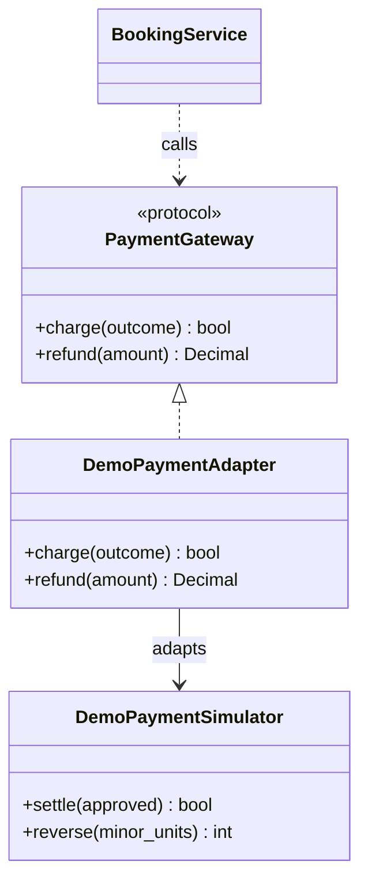
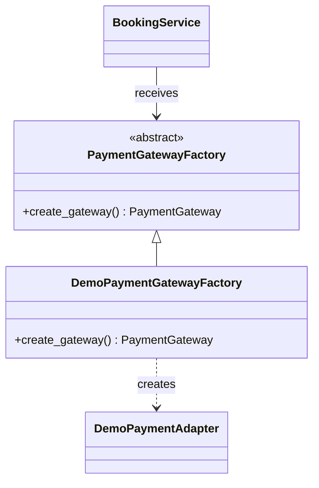
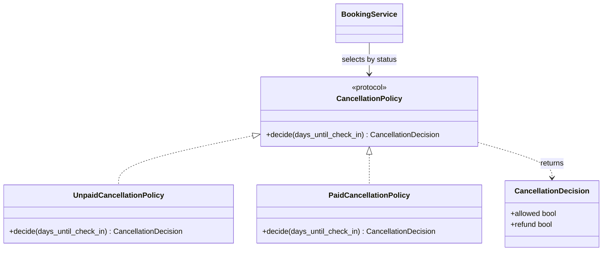
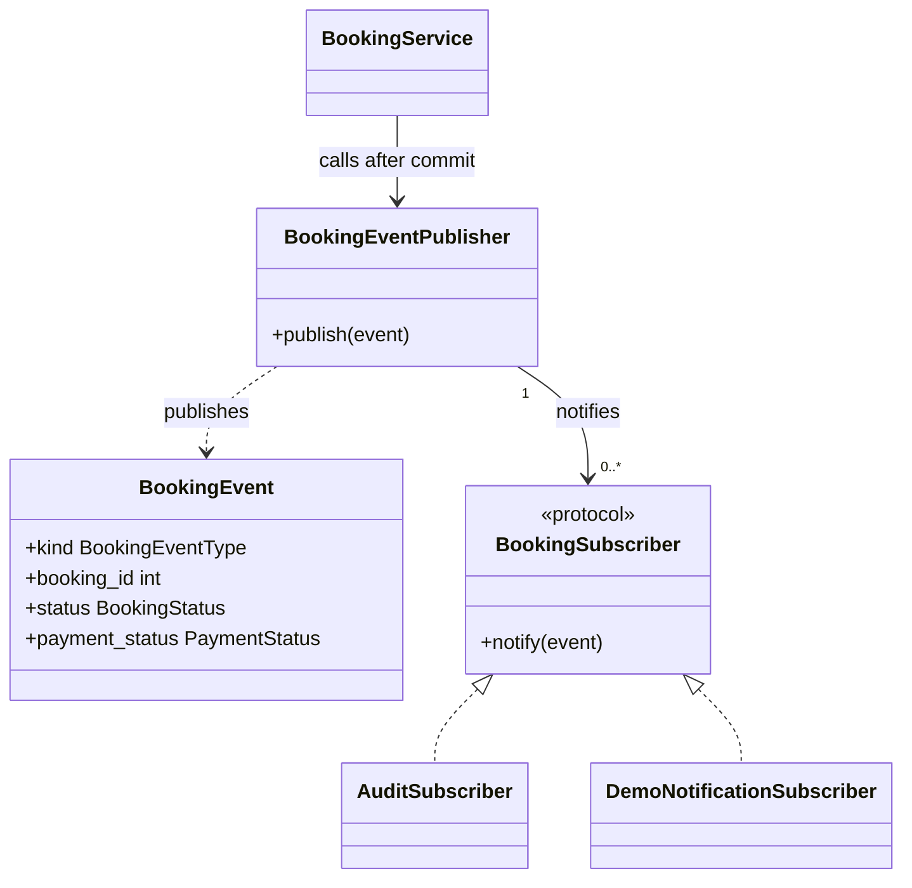
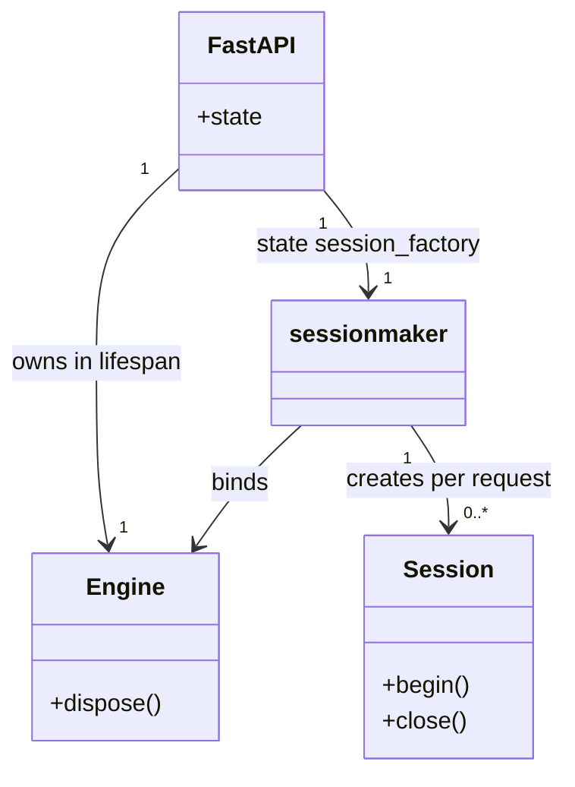

# Паттерны в жизненном цикле брони

В репозитории нет отдельного файла ТЗ. Сверка опирается на пять паттернов, перечисленных в условиях спринта.

| Паттерн | Статус | Участники в backend |
| --- | --- | --- |
| Factory Method | Реализован | `PaymentGatewayFactory.create_gateway()`, `DemoPaymentGatewayFactory` |
| Singleton | В коде приложения не реализован | Lifespan FastAPI владеет пулом в пределах экземпляра приложения |
| Adapter | Реализован | `PaymentGateway`, `DemoPaymentAdapter`, `DemoPaymentSimulator` |
| Observer | Реализован | `BookingEventPublisher`, `AuditSubscriber`, `DemoNotificationSubscriber` |
| Strategy | Реализован | `CancellationPolicy`, `UnpaidCancellationPolicy`, `PaidCancellationPolicy` |

## Adapter

В [app/payments.py](../app/payments.py) сервис работает через `PaymentGateway`. `DemoPaymentAdapter` преобразует результат из API в булево значение для `DemoPaymentSimulator` и переводит суммы `Decimal` в целые минимальные денежные единицы при возврате. Симулятор работает локально. Адаптер участвует в оплате и полном возврате.

## Factory Method

`PaymentGatewayFactory` объявляет фабричный метод `create_gateway()`, а `DemoPaymentGatewayFactory` создаёт `DemoPaymentAdapter` и его симулятор. [app/main.py](../app/main.py) передаёт конкретную фабрику в `BookingService`. Сервис вызывает фабричный метод, когда нужно выполнить фактическую демо-операцию.

## Strategy

В [app/cancellation.py](../app/cancellation.py) `CancellationPolicy` определяет интерфейс правил. [BookingService](../app/services.py) выбирает `UnpaidCancellationPolicy` для `PENDING` и `PaidCancellationPolicy` для `CONFIRMED`. Обе политики допускают отмену до даты заезда UTC. У оплаченной брони полный возврат доступен за два календарных дня или раньше. Отмена за день проходит без возврата. Результат `CancellationDecision` определяет, выполнять ли изменение и вызывать ли адаптер.

## Observer

[app/booking_events.py](../app/booking_events.py) определяет `BookingEventPublisher` и двух подписчиков `AuditSubscriber` и `DemoNotificationSubscriber`. События `CREATED`, `PAYMENT_FAILED`, `CONFIRMED` и `CANCELLED` содержат ID брони и статусы без токена и хеша. `BookingService` публикует событие после успешного выхода из транзакции. Повторы без изменения состояния не публикуются. Сбой одного подписчика регистрируется, и вызов остальных продолжается.

Аудит и демонстрационное уведомление пишут отдельные сообщения INFO в лог Uvicorn. Публикация происходит в памяти процесса. При падении процесса после commit событие может потеряться, а события разных запросов могут выводиться в другом порядке.

## Singleton — решение по области жизни Engine

Класс Singleton в коде приложения отсутствует. В [app/main.py](../app/main.py) каждый экземпляр FastAPI создаёт свой `Engine` и `sessionmaker` в lifespan. При остановке Engine освобождает пул. [get_session](../app/database.py) выдаёт отдельную `Session` на запрос и закрывает её после запроса.

Lifespan уже задаёт одну фабрику сессий и один Engine в рамках запуска экземпляра. Дополнительный объект с областью видимости FastAPI повторил бы эту гарантию. Глобальный Singleton связал бы конфигурации и остановку независимых приложений одного процесса. Тест `test_engine_pool_lifecycle_is_isolated_per_application` поднимает два приложения, проверяет разные пулы и подтверждает, что остановка одного не закрывает пул второго. Диаграмма ниже показывает действующий жизненный цикл ресурсов.

**Вопрос преподавателю.** Нужно ли для сдачи показать все пять паттернов отдельными реализациями в исполняемом коде, или допустимы четыре реализации и обоснованное использование lifespan FastAPI вместо Singleton для Engine?

