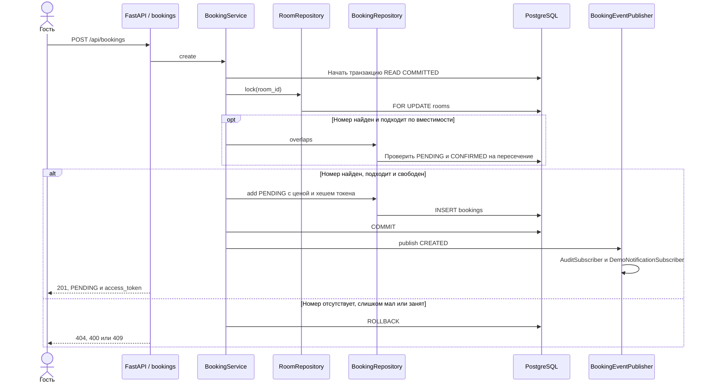
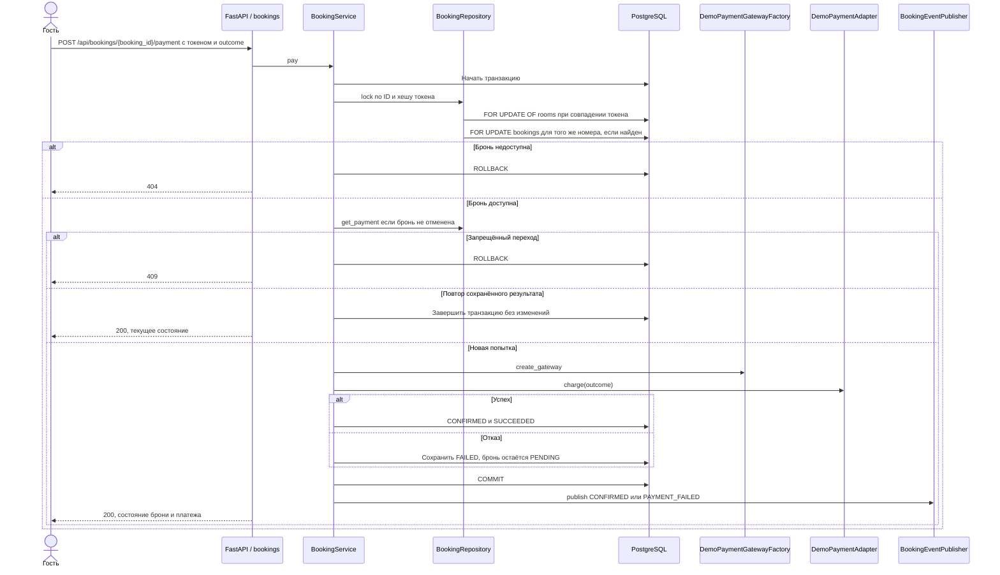
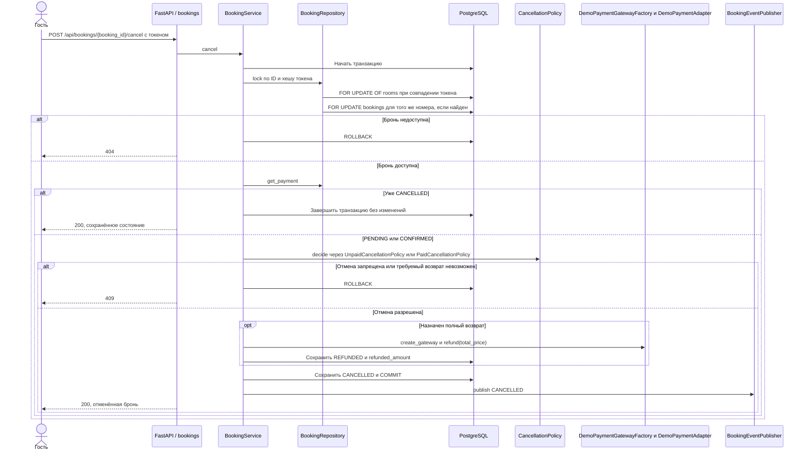

# Сценарии использования

Актор во всех сценариях — гость, который вызывает API через Swagger, PowerShell или будущий интерфейс. Клиентские сценарии описывают текущий backend. Способы запуска и поля приведены в [API-контракте](API_CONTRACT.md).

## Поиск номера

**Предусловия.** Backend доступен, миграции применены, в каталоге могут быть номера.

**Основной поток.** Гость вводит даты и число гостей. `GET /api/rooms/search` проверяет параметры, вместимость и пересечения активных броней на период `[check_in, check_out)`. Гость получает `200` со списком и открывает карточку через `GET /api/rooms/{room_id}`.

**Альтернативный поток.** Свободных подходящих номеров нет. API возвращает `200 []`, и гость может изменить даты или число гостей.

**Исключительный поток.** Некорректные даты, число гостей или ID дают `422`. Если карточка запрошена по ID отсутствующего номера, API возвращает `404`.

## Бронирование и demo-оплата

**Предусловия.** Гость выбрал номер и период. Доступность будет повторно проверена при создании.

**Основной поток.** Гость отправляет `POST /api/bookings`. Backend блокирует номер, проверяет доступность, сохраняет бронь `PENDING`, цену и хеш токена. После commit гость получает `201` с ID и одноразово выдаваемым токеном доступа. Затем он отправляет `POST /api/bookings/{booking_id}/payment` с заголовком `X-Booking-Access-Token` и результатом `SUCCEEDED`. API возвращает `200` с `CONFIRMED` и `payment.status = SUCCEEDED`.

**Альтернативный поток.** Результат `FAILED` возвращает `200`; бронь остаётся `PENDING`, платёж получает `FAILED`. Гость может повторить запрос с `SUCCEEDED`. Повтор уже сохранённого результата возвращает текущее состояние без нового вызова шлюза.

**Исключительный поток.** Для создания превышение вместимости даёт `400`, отсутствующий номер — `404`, пересечение — `409`. Отсутствующий или неверный токен в запросе оплаты даёт `404`. Оплата отменённой брони или запрос `FAILED` после подтверждения дают `409`. Некорректные входные данные дают `422`.

## Отмена

**Предусловия.** У гостя есть ID и токен. Для первой отмены текущая календарная дата UTC должна быть раньше даты заезда.

**Основной поток.** Гость отправляет `POST /api/bookings/{booking_id}/cancel`. При отмене оплаченной брони за два календарных дня или раньше backend сохраняет `CANCELLED`, платёж `REFUNDED` и полную сумму возврата. Гость получает `200`, а номер снова доступен на этот период.

**Альтернативный поток.** Неоплаченная бронь отменяется без возврата. За один календарный день до заезда оплаченная бронь отменяется без возврата, а платёж остаётся `SUCCEEDED`. Повторная отмена возвращает сохранённое состояние без повторного возврата.

**Исключительный поток.** Несуществующая или недоступная по токену бронь даёт `404`. В день заезда или позднее первая отмена даёт `409`. Некорректный ID даёт `422`.

## Диаграммы последовательностей

### Создание брони

### Demo-оплата

### Отмена

В каждой диаграмме событие публикуется только после успешного commit. При ошибке записи транзакция откатывается без события.
